# Vote Social

A social media platform for elections that helps voters, candidates, and voting blocks/orgs connect around local political participation.

## Project Summary

Vote Social is a civic engagement platform centered on three core user groups:

1. **Candidates**
2. **Voting blocks / organizations**
3. **Voters**

The product combines candidate discovery, local public discussion, supporter pledges, election notifications, and direct communication tools in one place.

## Core User Capabilities

### Voters can

- Learn about candidates
- Read and write opinions in a hyper-local public forum with upvote/downvote mechanics
- Pledge voting support to a candidate or a voting block
- Receive notifications about upcoming elections, including polling locations
- Subscribe to notifications from candidates, threads, and organizations on an opt-in basis
- Communicate with candidates and organizations
- Leave candidate testimonials

### Candidates can

- Share their platform
- Answer surveys
- Share their bio / CV
- Share media
- Receive lawn sign requests
- Participate in forums

### Voting blocks / organizations can

- Send blast communications to subscribers
- Pledge voting block support to a candidate list
- Publish and pin official communication within their own forum

## Product Strategy

The launch plan should be staged so we can test market viability before investing in the heavier operational and data-maintenance work.

### Stage 1: Advanced Waitlist

Goal: validate demand, messaging, and early interest before building the full platform.

Required work:

- Build waitlist screens populated with realistic fake data to communicate the future product experience
- Establish a cohesive design language that can carry into the full app
- Set up Firebase for waitlist signup capture and basic user acquisition tracking

Success criteria:

- Users understand the product concept quickly
- Signups can be captured and measured
- We can test messaging, design, and interest without building the full backend

### Stage 2: Foundation Build

Goal: implement the minimum platform infrastructure needed for a reliable first release.

Required work:

1. Build and maintain an election-cycle database
2. Build a database of municipalities, Canadian postal codes, and polling associations
3. Pre-populate known organizations and NGOs
4. Pre-populate candidates by scraping materials from Elections Canada, Ontario, and municipal sources
5. Define admin ownership rules for candidates and organizations
6. Establish stronger verification flows for user promotion and trust

### Stage 3: Trust, Verification, and Management

Goal: ensure pages and communications are trustworthy and that ownership can be validated.

Requirements:

- Some candidates / organizations may exist without an admin user and function as unmanaged pages
- Promotion of a user to admin of a candidate campaign or organization requires stricter authentication
- DNS TXT record verification on official organization / campaign domains may be required
- User verification should include:
  - IP / geolocation checks
  - Optional identity verification
  - Email verification

### Stage 4: Engagement and Growth

Goal: expand communication, participation, and retention features.

Potential follow-up work:

- Notifications and subscription controls
- Candidate-to-voter messaging workflows
- Forum moderation tools
- Testimonials and endorsements
- Election reminders and polling location guidance

## Architecture & Diagrams

### Core Domain Abstraction: Global Issues vs. Jurisdiction-Scoped Policies

To make multi-tier federalism intuitive and allow voters to connect with relevant local peers, Vote Social separates civic topics into two first-order objects:

1. **`ISSUE` (Global Scope)**:
   - Top-level forum subjects (e.g., *Housing & Gentle Density*, *Transit & Mobility*, *Healthcare Access*, *Public Safety*, *Local Economy & Main Streets*).
   - Ranked on a user's feed via a composite function of **user preferences**, **popularity (vote counts)**, and **recent activity/relevance**.
2. **`POLICY` (Fixed Governance Scope — "Slice of the Federalist Pie")**:
   - Fixed to a specific governance tier (`Municipal` / `Regional` / `Provincial` / `Federal`) and jurisdiction (e.g., *City of Toronto*, *Province of Ontario*, *Government of Canada*).
   - Policies tag Issues (`ISSUE 1 ── * POLICY`). While similar policies may exist across different municipalities or provinces, users only ever see `POLICY` records within their verified jurisdictional slice.
   - In the **Election Summary (`/<toronto|ontario|canada>_<year>/summary`)** and **Election Center** views, the election URL scopes the view to the subset of global **Issues** that have active **Policies** attached at that tier of governance.

### 1. Entity Relationship Diagram (ERD)

The data model connects Canadian postal codes (`POSTAL_ZONE`) to multi-tier political boundaries (`ELECTION_SET` — Municipal Ward, Provincial Electoral District, and Federal Electoral District resolved via the OpenNorth Represent API). Because a postal code can overlap multiple districts at a given governance tier, users confirm their exact `ELECTION_SET` memberships (`USER_ELECTION_MEMBERSHIP`) during profile setup. A sparse `ELECTION_SET` collection (`electionSets/{setId}`) is dynamically created and maintained in Firestore with live `pending_user_count` counters (`count > 0`) as users join the waitlist.

```mermaid
erDiagram
    POSTAL_ZONE }o--o{ ELECTION_SET : "resolves_candidates_via_opennorth"
    USER ||--o{ USER_ELECTION_MEMBERSHIP : "confirms_on_profile"
    ELECTION_SET ||--o{ USER_ELECTION_MEMBERSHIP : "tracks_sparse_waitlist_count"
    ELECTION_SET ||--o{ POLLING_SUBDIVISION : "divides_into"
    POLLING_SUBDIVISION ||--|| POLLING_STATION : "assigned_to"

    ISSUE ||--o{ POLICY : "tags_one_to_many"
    ELECTION_SET ||--o{ POLICY : "scopes_local_slice"
    ELECTION_RACE ||--o{ POLICY : "debates_at_tier"
    ISSUE ||--o{ USER_ISSUE_PREFERENCE : "weighted_by"
    USER ||--o{ USER_ISSUE_PREFERENCE : "configures"

    ELECTION_CYCLE ||--o{ ELECTION_RACE : "includes"
    ELECTION_SET ||--o{ ELECTION_RACE : "hosts_at_boundary"
    ELECTION_RACE ||--o{ CANDIDATE_PROFILE : "contested_by"
    ELECTION_RACE ||--o{ CIVIC_EVENT : "schedules"

    USER ||--o| CANDIDATE_PROFILE : "claims_and_manages"
    USER }o--o{ VOTING_ORGANIZATION : "administers"
    USER }o--|| POSTAL_ZONE : "enters_on_waitlist"

    %% Candidate <-> Policy Junction Table & Candidate Files
    CANDIDATE_PROFILE ||--o{ CANDIDATE_POLICY : "takes_stance_on"
    POLICY ||--o{ CANDIDATE_POLICY : "evaluated_by"
    CANDIDATE_PROFILE ||--o{ FILE : "has_many"
    CANDIDATE_PROFILE ||--o{ VOTING_RECORD : "has_history"

    VOTING_ORGANIZATION ||--o{ ORG_ENDORSEMENT : "publishes_slate"
    CANDIDATE_PROFILE ||--o{ ORG_ENDORSEMENT : "receives"

    USER ||--o{ VOTER_PLEDGE : "casts"
    CANDIDATE_PROFILE ||--o{ VOTER_PLEDGE : "receives_independent_support"
    VOTING_ORGANIZATION ||--o{ VOTER_PLEDGE : "receives_org_support"

    USER ||--o{ LAWN_SIGN_REQUEST : "requests"
    CANDIDATE_PROFILE ||--o{ LAWN_SIGN_REQUEST : "fulfills"

    USER ||--o{ TESTIMONIAL : "writes"
    CANDIDATE_PROFILE ||--o{ TESTIMONIAL : "featured_on"

    %% Candidates, Issues, Policies, and Organizations all have many Posts
    CANDIDATE_PROFILE ||--o{ POST : "has_many"
    ISSUE ||--o{ POST : "has_many"
    POLICY ||--o{ POST : "has_many"
    VOTING_ORGANIZATION ||--o{ POST : "has_many"
    ELECTION_SET ||--o{ POST : "scopes"
    USER ||--o{ POST : "authors"

    POST ||--o{ POST_REPLY : "contains"
    USER ||--o{ POST_REPLY : "authors"
    CANDIDATE_PROFILE ||--o{ POST_REPLY : "answers_officially"

    POST ||--o{ POST_VOTE : "ranked_by"
    USER ||--o{ POST_VOTE : "upvotes"
    ISSUE ||--o{ ISSUE_VOTE : "ranked_by"
    USER ||--o{ ISSUE_VOTE : "votes_on"

    USER ||--o{ SUBSCRIPTION : "opts_into"
    CANDIDATE_PROFILE ||--o{ SUBSCRIPTION : "notifies"
    VOTING_ORGANIZATION ||--o{ SUBSCRIPTION : "broadcasts_to"
    POST ||--o{ SUBSCRIPTION : "alerts"

    ELECTION_SET {
        string id PK "Deterministic slug from OpenNorth boundary URL"
        string open_north_url "e.g. /boundaries/kitchener-wards/ward-10/"
        string name "e.g. Ward 10 | Kitchener Centre"
        string boundary_set_name "e.g. Kitchener ward | Ontario electoral district"
        string tier "municipal | provincial | federal"
        string external_id "nullable"
        string city "nullable"
        string province "nullable"
        int pending_user_count "Sparse waitlist counter (>0 rendered)"
        timestamp updated_at
    }

    USER_ELECTION_MEMBERSHIP {
        string user_id FK
        string election_set_id FK
        string tier "municipal | provincial | federal"
        timestamp confirmed_at
    }

    ISSUE {
        uuid id PK
        string slug
        string title "Global in scope"
        int global_popularity_score
        int local_vote_count
        timestamp last_activity_at
    }

    POLICY {
        uuid id PK
        uuid issue_id FK "Tags parent global Issue"
        string governance_tier "Regional | Councilor | Mayoral | Provincial | Federal"
        string election_set_id FK "Scoped to user federalist slice"
        string code
        string title
        string summary
    }

    CANDIDATE_POLICY {
        uuid id PK
        uuid candidate_profile_id FK
        uuid policy_id FK
        string stance "Strong Support | Conditional Support | Phased Approach | Opposes"
        string summary_rationale
        string direct_quote
        boolean is_key_plank
    }

    FILE {
        uuid id PK
        uuid candidate_profile_id FK
        string file_type "bio_cv | platform_doc | media_clip | disclosure"
        string title
        string mime_type
        string url
        timestamp uploaded_at
    }

    USER {
        string uid PK
        string email
        string first_name
        string last_name
        string postcode
        string city
        string province
        string_array election_set_ids "Confirmed Municipal, Provincial, Federal IDs"
        boolean is_candidate
        string candidate_election "nullable"
        boolean is_org_representative
        string organization_name "nullable"
        boolean is_journalist
        string published_article_url "nullable"
        boolean profileComplete
    }

    CANDIDATE_PROFILE {
        uuid id PK
        uuid election_race_id FK
        uuid claimed_by_user_id FK "nullable for unmanaged pages"
        string name
        string platform_summary
        string verified_domain
        int independent_voter_count
        boolean is_claimed
    }

    VOTING_ORGANIZATION {
        uuid id PK
        string name
        string category
        string verified_domain "DNS TXT verified"
        string pinned_announcement
        int subscriber_count
    }

    ELECTION_RACE {
        uuid id PK
        uuid election_cycle_id FK
        string election_set_id FK
        string tier "Regional | Councilor | Mayoral | Provincial | Federal"
        string district_name
        date election_date
    }

    POST {
        uuid id PK
        uuid author_user_id FK
        uuid candidate_profile_id FK "nullable"
        uuid issue_id FK "nullable"
        uuid policy_id FK "nullable"
        uuid organization_id FK "nullable"
        string election_set_id FK "nullable"
        string title
        string content
        boolean is_pinned
        int vote_score
        timestamp recent_activity_at
    }
```

---

### 2. Sitemap & User Actions

The sitemap below outlines the navigation hierarchy from the Stage 1 Waitlist (3-step registration + OpenNorth boundary disambiguation + live sparse `electionSets` counters) through the 3 core product hubs and role-specific actions for **Voters**, **Candidates**, and **Voting Blocks / Organizations**.

```mermaid
flowchart TD
    subgraph Public["Public & Stage 1 Waitlist"]
        Landing["/ — Waitlist Landing Page (Step 1: Email Capture + Active ElectionSet Counters)"]
        Register["/register — Step 2: Password or Google OAuth + /verify-email"]
        ProfileSetup["/profile — Step 3: Name, Postcode -> OpenNorth Boundary Disambiguation & Role Flags"]
        ElectionSetsCounter["Firestore: Sparse electionSets/{setId} (Maintained on profile save, filtered by count > 0)"]
        Landing --> Register
        Register --> ProfileSetup
        ProfileSetup --> ElectionSetsCounter
    end

    subgraph CoreApp["Core Civic Application (Scoped by Federalist Slice & Postal Code)"]
        direction TB

        subgraph Screen1["1. Election Summary & Issue Feed (/<toronto|ontario|canada>_<year>/summary)"]
            CandidateRow["Top Row: Candidate Summary Cards (Links to /candidates, Key Issues, Org Supports + Voter Counts, Unaffiliated Voters Badge)"]
            IssueActivityFeed["Left Column: Searchable Feed of Issues by Recent Activity & Policies"]
            TopIssuesByVote["Right Column: Simplified Top Issues by Vote (Issue Links & Vote Counts)"]
            OrgGuides["Right Column: Organization & Voter Guides"]
            CandidateQA["Verified Candidate Q&A & Policy Citations"]
        end

        subgraph Screen2["2. Candidate Profiles (/<toronto|ontario|canada>_<year>/candidates)"]
            CandidateCards["Top Row: Candidate Cards (Issue Badges, Org Badges + Unaffiliated Voter# Badge, Your Vote Badge)"]
            CandidateDossier["Zero-Margin Candidate Summary (Tagline CTAs, Files, Voting Record, Media)"]
            TestimonialsDM["Right Column: Peer Voter Testimonials & Direct Messaging"]
        end

        subgraph Screen3["3. Voter Dashboard (/screens/election-center)"]
            CivicCalendar["Top Row: Election Calendar (Weekly Default / Monthly Toggle • Followed Candidate/Org Events & Global Election Dates)"]
            ActiveElections["Your Active Elections Cards (Links to Election Summary + Endorses Badge)"]
            FollowSubscriptions["Followed Issues, Candidates & Organizations + Granular Notification Settings"]
            PollLocator["Interactive Polling Place Map, Hours & Voter ID Guide"]
        end
    end

    subgraph RoleActions["User Group Actions & Workflows"]
        direction TB
        VoterActor["Voter Actions"]
        CandidateActor["Candidate Actions (DNS / ID Verified)"]
        OrgActor["Voting Block / Org Actions (DNS TXT Verified)"]
    end

    ProfileSetup --> Screen1
    ProfileSetup --> Screen2
    ProfileSetup --> Screen3

    %% Voter Actions
    VoterActor -->|"Browse candidate cards, filter issue feed, vote on issues"| IssueActivityFeed
    VoterActor -->|"Navigate from Election Summary to Candidate Profiles"| CandidateCards
    VoterActor -->|"Pledge support, request lawn sign, inspect files & media, write testimonials"| CandidateDossier
    VoterActor -->|"Follow issues, candidates & orgs; configure granular notification settings"| FollowSubscriptions
    VoterActor -->|"View weekly/monthly calendar, check active elections & locate polling station"| CivicCalendar

    %% Candidate Actions
    CandidateActor -->|"Claim unmanaged profile via domain/ID verification"| CandidateDossier
    CandidateActor -->|"Upload candidate files (cv.pdf, resume.pdf), voting record & media"| CandidateDossier
    CandidateActor -->|"Post highlighted Official Candidate Q&A replies on local policies"| CandidateQA
    CandidateActor -->|"Publish campaign events to followers' Election Calendars"| CivicCalendar

    %% Voting Block / Organization Actions
    OrgActor -->|"Verify official domain via DNS TXT record"| OrgGuides
    OrgActor -->|"Publish endorsed candidate slate & voter alignment counts"| CandidateRow
    OrgActor -->|"Pin official announcements & send opt-in subscriber blasts"| OrgGuides
```

## Roadmap

### Near term

- Define the visual system and UX patterns for the waitlist experience
- Create high-fidelity mock screens using fake data
- Stand up Firebase signups and basic analytics

### Mid term

- Design the election data model
- Define geo/polling-location lookup data structures
- Build import and maintenance workflows for municipalities, candidates, and organizations

### Longer term

- Build verification and admin-claim flows
- Add communication and subscription features
- Add moderation, trust, and safety tooling
- Expand candidate, voter, and organization participation features

## Open Questions

- What is the initial geographic scope: one municipality, one province, or all of Canada?
- What data sources will be authoritative for election cycles and polling information?
- What level of moderation will the public forum require at launch?
- Which features are required for the first public beta versus later releases?

## Notes

Further issues will likely emerge downstream as the product, data model, and trust systems mature.
